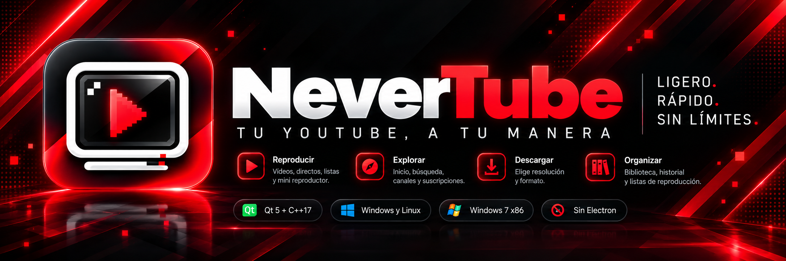

<div align="right">
  <a href="README.md">English</a> · <b>Español</b>
</div>

<p align="center">
  
</p>

<p align="center">
  <a href="https://github.com/marlo4220mc/NeverTube/releases"></a>
  
  
  
  
</p>

# NeverTube

**NeverTube** es un cliente ligero de YouTube para Windows (7 / 10 / 11) y Linux, hecho con Qt5 y C++17. Reproduce directamente desde la API web no oficial de YouTube — sin navegador, sin Electron y, en Linux, sin runtime empaquetado: los paquetes pesan ~1 MB y se traen sus dependencias de los repositorios de la propia distribución.

## Funciones

**Reproducción**

- **Dos motores de reproducción**: libmpv en Linux, Windows x64 y Windows 10 x86, y un motor FFmpeg/libav propio para Windows x86 (Win7)
- Sondeo de hardware al inicio (AV1 / VP9 / H.264) que elige el perfil de códec que la máquina decodifica de verdad, y baja un escalón solo si un perfil termina decodificando por software
- Directos (insignia en la miniatura y modo de reproducción en directo), AV1 sintético sobre HLS, retoma donde lo dejaste
- Cola "A continuación" sembrada con la radio de YouTube (mezcla estilo Music) o con sugerencias estáticas, aleatorio y repetición, mini player
- Atajos: `Espacio` / `K` reproducir-pausa, `J` / `L` ±10 s, `←` / `→` ±5 s, `N` siguiente, `P` anterior (reinicia primero si pasaste los 5 s), `↑` / `↓` volumen, `M` silencio, `F` pantalla completa, `D` menú de descarga
- Recuperación automática de sesiones gateadas por YouTube (403): re-resolución en una sesión nueva y, como último recurso, reinicio con el último vídeo

**Navegación**

- Inicio con Continuar viendo, Nuevos de tus suscripciones, Recomendado y Descubre (las radios que se generan de lo que reproducís quedan guardadas y se reutilizan)
- Búsqueda con sugerencias en vivo; pegar un enlace de YouTube abre ese vídeo en vez de buscar el texto
- Páginas de canal (pestañas vídeos / shorts / directos), playlists, historial
- Biblioteca con suscripciones, playlists e historial; el menú de la fila cubre Ver más tarde, añadir a playlist, compartir y ver canal
- Los Shorts quedan fuera de las listas (cola, continuar viendo, descubre): el reproductor es 16:9 y un vertical en una cuadrícula rompe la fila

**Descargas** — desde el botón del reproductor o la pestaña Descargas

- Submenú de resolución con las variantes de códec y su tamaño real, o solo el audio
- Fragmentos pedidos por rango de bytes en paralelo y reanudables; un 401/403 re-resuelve las URLs y continúa con lo que ya está en disco
- Unido con `ffmpeg` como copia de flujo (sin recodificar): el vídeo como MKV, el audio como MP3 (M4A cuando el ffmpeg no trae codificador MP3). Los instaladores de Windows llevan su propio ffmpeg
- Una descarga a la vez, con vídeo y audio como filas separadas; progreso y velocidad por fila, pausar / continuar, reintentar, borrar (opcionalmente el fichero), abrir carpeta, pausar todo / reanudar todo
- Carpeta por defecto `Descargas/NeverTube` (configurable), de 1 a 16 conexiones (8 es el óptimo medido) y, mientras hay un vídeo reproduciéndose, la descarga baja la prioridad de sus propios hilos para que el reproductor no pierda fotogramas

**Interfaz**

- Cuadrícula (4 / 5 / 6 columnas) y lista, tres tamaños de miniatura, siete colores de acento, cambio de idioma en caliente (español / inglés; un idioma nuevo es un fichero JSON en `localization/`)
- Una instancia por usuario: un segundo lanzamiento (un enlace, un `--download`) le pasa sus argumentos a la ventana que ya está abierta en vez de abrir una segunda copia de la base

## Descarga

Las compilaciones están en la página de [Releases](https://github.com/marlo4220mc/NeverTube/releases), todas salidas del mismo commit, con `SHA256SUMS.txt` al lado (`sha256sum -c SHA256SUMS.txt` comprueba una descarga). Todo lo produce `.github/workflows/release.yml`; lo que hace el pipeline y cómo se corta una release está en [`docs/release/README.md`](docs/release/README.md).

En Linux solo x86_64.

| Formato | Destino | Fichero |
|---|---|---|
| `.deb` | Ubuntu 22.04 / Mint 21 / Debian 12 | `NeverTube-<versión>-Ubuntu-22.04-amd64.deb` |
| `.deb` | Ubuntu 24.04 / Mint 22 / Debian 13 | `NeverTube-<versión>-Ubuntu-24.04-amd64.deb` |
| `.rpm` | Fedora (familia RHEL con esos sonames) | `NeverTube-<versión>-Fedora-x86_64.rpm` |
| pacman | Arch Linux | `NeverTube-<versión>-Arch-Linux-x86_64.pkg.tar.zst` |
| Flatpak | cualquier distribución, incluidas las inmutables | `NeverTube-<versión>-Linux-Flatpak.flatpak` |
| Repo OSTree | `flatpak update` desde un repo alojado | `NeverTube-<versión>-Linux-Flatpak-Repo.tar.gz` |
| setup.exe | Windows 10 / 11 (x64) | `NeverTube-<versión>-Windows-10-11-x64-Setup.exe` |
| setup.exe | Windows 10 / 11 (x86) | `NeverTube-<versión>-Windows-10-11-x86-Setup.exe` |
| setup.exe | Windows 7 SP1 (x86) | `NeverTube-<versión>-Windows-7-SP1-x86-Setup.exe` |

Hay **dos `.deb`** a propósito: 24.04 renombró los paquetes de Qt5 al esquema `t64` y trae FFmpeg 6.1, así que un paquete compilado en 22.04 no se instala ahí ni al revés. Es el mismo programa compilado contra cada base.

### Instalación

- Debian / Ubuntu: `sudo apt install ./NeverTube-<versión>-Ubuntu-24.04-amd64.deb` — apt instala automáticamente las dependencias declaradas. En **Ubuntu 22.04 (jammy) y 24.04 (noble)** el paquete además configura el repositorio APT firmado del proyecto: instala `/usr/share/keyrings/nevertube-archive-keyring.gpg` (la clave pública) y escribe `/etc/apt/sources.list.d/nevertube.list` con `signed-by=`, así que el siguiente `apt update && apt upgrade` recibe las versiones nuevas. El postinst **no necesita red** y no ejecuta `apt update`; en cualquier otra distribución (Debian, Fedora, una Ubuntu que no sea 22.04 ni 24.04) imprime un aviso y no toca apt, y al desinstalar el paquete se quita la fuente que había añadido.
- Fedora: `sudo dnf install ./NeverTube-<versión>-Fedora-x86_64.rpm` — dnf resuelve los requisitos por sonames (`ffmpeg-free`, o el ffmpeg de RPM Fusion si ya está instalado).
- Arch: `sudo pacman -U NeverTube-<versión>-Arch-Linux-x86_64.pkg.tar.zst`
- Flatpak: `flatpak install --user https://marlo4220mc.github.io/NeverTube/flatpak/io.github.marlo4220mc.NeverTube.flatpakref` — un solo comando añade el repositorio firmado e instala la app, así que `flatpak update` la mantiene al día. Alternativamente, puedes instalar el bundle de un solo fichero (`flatpak install --user NeverTube-<versión>-Linux-Flatpak.flatpak`), que ahora también autoconfigura el repositorio remoto y la firma GPG. Los permisos, las actualizaciones y las comprobaciones manuales están en `packaging/linux/flatpak/README.md`.
- Windows: ejecuta el setup de tu sistema — `NeverTube-<versión>-Windows-7-SP1-x86-Setup.exe` (Windows 7 de 32 bits), `NeverTube-<versión>-Windows-10-11-x86-Setup.exe` (Windows 10/11 de 32 bits) o `NeverTube-<versión>-Windows-10-11-x64-Setup.exe` (Windows 10/11 de 64 bits). Cada uno rechaza los otros dos y te dice cuál usar; instalan el re-distribuible de VC++ que necesitan. Los instaladores no están firmados, así que SmartScreen avisa la primera vez.

El binario es `nevertube`. En Linux la entrada `.desktop` y los iconos se instalan en el tema `hicolor`, así que la app aparece en el menú como **NeverTube**.

### Compilar desde el código

```sh
cmake -B build && cmake --build build
```

Dependencias: Qt5 (Core, Gui, Widgets, Network, Sql), OpenGL, libmpv. La compilación de Windows 7 x86 usa el paquete de FFmpeg incluido en `third_party/ffmpeg-win32/` (ver `BUILD_WINDOWS.md`); las descargas necesitan el **ejecutable** `ffmpeg` en tiempo de ejecución (los paquetes de Linux lo declaran, los instaladores de Windows lo llevan).

Tests de regresión offline (sin red ni GPU) — 24, uno por subsistema:

```sh
./build/nevertube --selftest-db        # repositorios y SQLite
./build/nevertube --selftest-grid      # geometría de la cuadrícula
./build/nevertube --selftest-theme     # QSS y paleta de selección
./build/nevertube --selftest-i18n      # catálogos de idioma
./build/nevertube --selftest-download  # plan de descarga
```

La lista completa, con lo que cubre cada uno, está en `AGENTS.md`.

## Línea de comandos

```
nevertube                            # la app
nevertube --search <consulta>        # buscar al arrancar
nevertube --channel <channelId>      # abrir un canal
nevertube --playlist <playlistId>    # abrir una playlist de YouTube
nevertube <url-de-youtube>           # reproducir un vídeo
nevertube --download <videoId> [altura|audio]
nevertube --pause-download <videoId>
nevertube --resume-download <videoId>
nevertube --play-local <fichero>     # reproducir una descarga
nevertube --downloads | --library    # abrir esa página
```

## Limitaciones

- Windows x86 (Win7): sin AV1 (ni hardware ni software); el perfil de códec llega a `h264-hw` (DXVA2). El setup x86 se niega a instalarse en Windows 10/11 de 64 bits y remite a la compilación x64, donde esa misma máquina rinde mejor.
- Windows x64: la ruta por defecto `d3d11va-copy` consume más CPU; hay un modo experimental de zero-copy (`NEVERTUBE_ANGLE=1`, ANGLE + `d3d11-egl`) opt-in.
- Los paquetes de Linux son solo x86_64.
- La app usa la API web no oficial de YouTube para resolver streams y el estado en vivo. Este proyecto no está afiliado, respaldado ni conectado oficialmente con YouTube o Google.

## Apoyar el proyecto

<p align="center">
  <br>
  <b>¿Te gusta NeverTube?</b><br>
  ¡Dale una estrella ⭐ al repositorio, compártelo con tus amigos o apoya el desarrollo continuo del proyecto!
</p>

## Licencia

GPL-3.0-or-later. Los componentes de terceros conservan sus propias licencias: Qt5 (LGPL-3.0), libmpv (LGPL-2.1+), FFmpeg (LGPL-2.1+), LAME (LGPL-2.0, el codificador MP3 del ffmpeg de Windows), geometría de iconos Material Symbols (Apache-2.0), OpenSSL (Apache-2.0).
